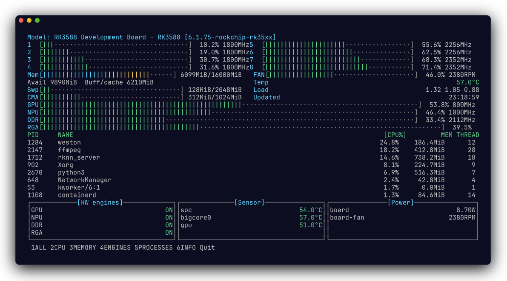
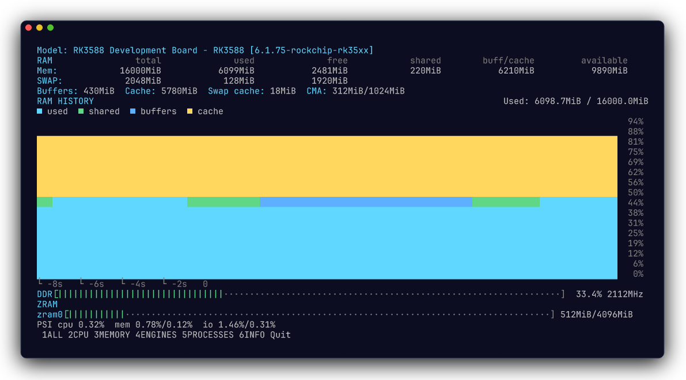
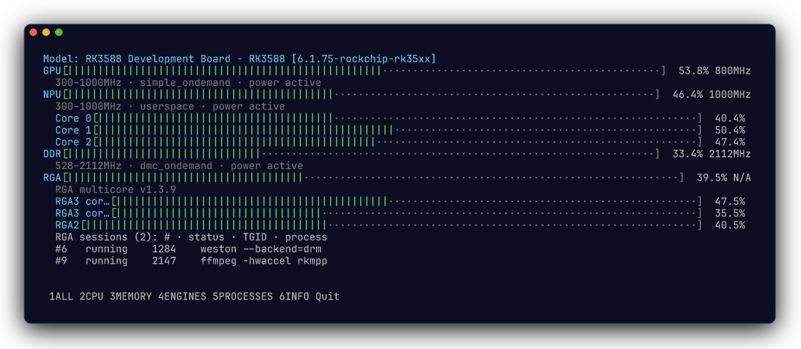

# rtop

[简体中文](README.md) | English

rtop is a read-only terminal system monitor for Rockchip Linux platforms. The
current implementation includes generic Linux collectors, process ranking, an
interactive terminal interface, and RK3588 GPU/NPU/DDR devfreq metrics plus
RGA scheduler load. It also reports CPU/devfreq policy limits and governors,
runtime power state, thermal trip points and cooling state, PSI pressure, CMA,
zram statistics, hwmon power rails and fan state when the kernel exposes them.
Per-core RKNPU load is shown when its debugfs node is readable; otherwise each
core is explicitly marked `permission_denied`.

When the unified Rockchip RGA driver exposes `/sys/kernel/debug/rkrga/load` or
`/proc/rkrga/load`, rtop shows per-scheduler RGA load, their arithmetic mean,
reported session status, TGIDs and process commands, and the driver version. Malformed
session rows are skipped and reported without invalidating scheduler load. The
interface does not attribute scheduler utilization to individual processes.
Older RGA/RGA2 drivers usually lack load accounting;
rtop reports those interfaces as `unsupported` instead of estimating usage.

## Screenshots

These screenshots use the real rtop TUI rendered with representative RK3588
data. Click an image to view it at full size.

### System overview

[](docs/images/rtop-overview.png)

### Memory and pressure

[](docs/images/rtop-memory.png)

### Rockchip engines

[](docs/images/rtop-engines.png)

## Build

```sh
go build -buildvcs=false ./cmd/rtop
```

## Install

Install the latest Linux ARM64 release from GitHub:

```sh
curl -fsSL https://raw.githubusercontent.com/zouri/rtop/main/scripts/install.sh | sudo sh
```

When GitHub connectivity is limited, install entirely from the Gitee mirror.
The script, latest-release metadata, archive, and checksum are all fetched from
Gitee:

```sh
curl -fsSL https://gitee.com/zouri/rtop/raw/main/scripts/install.sh | sudo env RTOP_SOURCE=gitee sh
```

The installer verifies the release checksum and requires root privileges to
install the binary globally as `/usr/bin/rtop`. This keeps the command
available to both regular users and commands executed through `sudo`.
`RTOP_VERSION` works with both GitHub and Gitee; pass `RTOP_VERSION=v0.2.0` to
install a specific release:

```sh
curl -fsSL https://raw.githubusercontent.com/zouri/rtop/main/scripts/install.sh | sudo env RTOP_VERSION=v0.2.0 sh
```

## Usage

```text
rtop
rtop info
rtop info --json
rtop snapshot --json
rtop snapshot --watch --interval 1s
rtop snapshot --watch --top 20
rtop snapshot --watch --no-processes
rtop --interval 1s --process-interval 2s --thermal-interval 5s
rtop doctor
rtop doctor --json
```

The TUI follows a jtop-style board monitor layout. The layout responds to
terminal resizing down to 24 columns by 8 rows. Smaller windows show a compact
resize hint instead of drawing clipped panels.

- `1`: ALL board overview.
- `2`: total CPU load, per-core history charts, frequency ranges, and governors.
- `3`: `free`-style `total / used / free / shared / buff/cache / available` and swap
  details, plus buffers, cache, swap cache, CMA, PSI, zram, and DDR status. The
  memory history uses jtop-style colors for used, shared, buffers, and cache.
- `4`: Rockchip engine load, frequency, devfreq policy, runtime state, and per-core status.
- `5`: process table.
- `6` or `i`: board, driver and metric-source information.
- `←`/`→` or `Tab`: cycle through pages as in jtop.
- `?`: show Help without leaving the active page.
- `↑`/`↓` or `j`/`k`: select a process or scroll a detail page.
- `c`/`m`: sort processes by CPU or memory.
- `p`: show or hide executable paths on the ALL and PROCESSES pages.
- `Enter`: toggle details for the selected process.
- `r`: request an immediate refresh.
- `q` or `Ctrl+C`: exit.

Every metric reports a status and source. Missing or unreadable nodes are never
reported as a zero measurement. Use `--root testdata/generic-linux` to run
against a fixture tree instead of the live system.

CPU, memory, accelerator, power and fan metrics follow `--interval`. Process
and thermal collection use lower default cadences of 2s and 5s respectively to
reduce observer overhead; adjust them with `--process-interval` and
`--thermal-interval`. Pressing `r` forces the active page's collectors to
refresh.

The TUI also collects by page. ALL collects the board-wide view, CPU collects
only CPU metrics, Memory collects memory and DDR metrics, Engines collects
accelerator metrics, Processes scans only processes, and Info
reads the lightweight capability groups. Help is an overlay and does not change
the active collection scope. The UI retains the last value for groups that are
not collected on the active page instead of presenting them as missing.

For headless output, `snapshot --top N` emits only the busiest N processes and
`snapshot --no-processes` skips process collection entirely.

## Diagnostics

`rtop doctor` checks platform detection, devfreq drivers, debugfs mounting and
permissions, DVFS controls, memory-pressure capabilities, thermal controls,
hwmon power/fan capabilities, and the selected source for each metric. It is
read-only and never mounts filesystems or changes permissions. See
[docs/diagnostics.md](docs/diagnostics.md) for interpreting the report. The
CPUFreq policy model, RK3588 shared frequency domains, and `Frq` status meanings
are documented in [docs/cpufreq.md](docs/cpufreq.md).

## Packaging

```sh
make package VERSION=v0.1.0
```

This creates an ARM64 tarball, Debian package and `SHA256SUMS` under `dist/`.
The current platform support status is documented in
[docs/support-matrix.md](docs/support-matrix.md).
